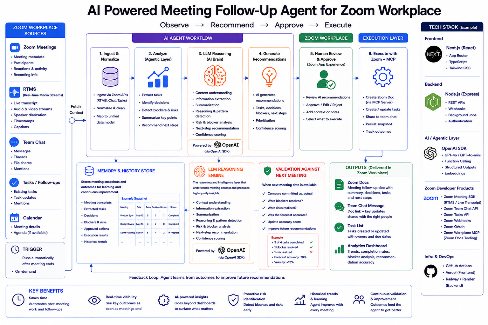

# Zoom Workplace Agent — Node.js Sample

This sample demonstrates a human-in-the-loop agentic workflow built on Zoom Workplace. Using Zoom RTMS, OPENAI SDK, Zoom Apps SDK, Zoom Chat, and Zoom MCP, the application observes meeting context, recommends follow-up actions, allows a user to review and approve those recommendations, and then executes the approved workflow.

The agent pattern is **Observe → Recommend → Approve → Execute** — every
state change is gated behind explicit human approval. AI never mutates
state on its own. Each extracted task arrives as a pending suggestion;
each generated artifact is previewed and approved before it ships.

## Run with Zoom Blueprint CLI

```bash
zoom create --name hitl-demo --template hitl-workplace-agent
cd apps/hitl-demo
npm run install:all
zoom dev
```

Use Node.js 22.23.5 (verified). The CLI starts the backend before the frontend, synchronizes the public URL, and links directly to the Marketplace settings needed for setup. AI keys can be added later; live AI features require the corresponding key. The pattern demonstrated is **Observe → Recommend → Approve → Execute**.

This template is based on [Zoom’s official sample](https://github.com/zoom/human-in-the-loop-workplace-agent-sample/tree/66a3740723b032a87457e2f41d6ad52cc33b0b7d), with CLI onboarding, manifest placeholders, startup ordering, optional-AI checks, and dependency fixes applied. The sample’s own OAuth credentials are separate from `zoom login`, which authorizes the CLI to manage Marketplace apps.

### Built With

| Technology             | Purpose                                                                                                                                                               |
| ---------------------- | --------------------------------------------------------------------------------------------------------------------------------------------------------------------- |
| **Zoom RTMS**          | Captures live meeting transcripts for real-time analysis.                                                                                                             |
| **Zoom Apps SDK**      | Powers the in-meeting app experience, RTMS controls, Zoom Chat shortcut modals, and sharing content back to chat via `sendMessageToChat`.                             |
| **OpenAI SDK**         | Analyzes transcripts to generate task suggestions, summaries, decisions, and risks. Also powers Zoom Doc creation through the Responses API and Zoom MCP integration. |
| **Zoom MCP**           | Enables AI-assisted creation of Zoom Docs from approved meeting context and follow-up content.                                                                        |
| **Zoom Chat Bot** | Supports manual task creation workflows, shortcut-driven note creation, and threaded notifications for AI-generated suggestions.                                      |
| **Zoom Tasks API**     | Optionally syncs approved tasks into Zoom Workplace Tasks.                                                                                                            |
| **Next.js**            | Provides the user-facing dashboard, including Overview and AI Actions experiences.                                                                                    |
| **Node.js**            | Hosts backend services, Zoom integrations, AI orchestration, and workflow processing.                                                                                 |


---
## Architecture

---

<details>
<summary><strong>What this app demonstrates</strong></summary>

### The Continuous Meeting Chat lifecycle

```
BEFORE — open /
    open tasks · pending approvals · recent meeting summaries

DURING — Apps panel in the meeting → click your app
    Start RTMS button → Zoom fires meeting.rtms_started
    transcript segments stream live to /meetings/<uuid>/live (SSE)
    keyword matcher auto-completes obvious tasks ("I just sent the deck")

AFTER — meeting.rtms_stopped fires
    AI extracts suggested tasks from the transcript
    AI generates summary + decisions + risks
    threaded Zoom Chat update: "N task suggestions detected"

REVIEW — open /suggestions
    approve / edit / reject each suggestion
    approve → real Task created locally + optional push to Zoom Tasks API
            → threaded Zoom Chat update
```

### Two Zoom Chat bot flows

| Flow | Trigger | Description |
|---|---|---|
| **Research Assistant** | Type `menu` → click "Research Assistant" | Ask any question; Anthropic Claude drafts a response in the thread |
| **Create Task** | Type `menu` → click "Create Task" | Multi-step form to create a task |

Text commands: `menu`, `help`, `start`, `services` to open the menu;
`cancel`, `stop`, `quit`, `exit` to abort a flow.

### AI Actions — Observe → Recommend → Approve → Execute

The Dashboard at `/` is now split into two tabs:

- **Overview** — the existing dashboard (counts, recent meetings, next actions, RTMS controls).
- **AI Actions** — proactive recommendations the system surfaces based on what it has observed about a meeting. Every action is gated by an explicit user approval before it runs.

The first AI Action is **Create Meeting Follow-up Doc**:

```
OBSERVE   The system inspects the selected meeting in TaskStore — approved tasks,
          pending AI suggestions, decisions, blockers, whether a summary exists.

RECOMMEND If any of those signals are present, the "Create Meeting Follow-up Doc"
          card appears with a plain-language "Why" list.

APPROVE   Click "Preview Document" → OpenAI generates a Markdown follow-up.
          The user can edit the Markdown freely before approving.

EXECUTE   Click "Approve & create Zoom Doc" → the backend calls the OpenAI
          Responses API with the Zoom MCP server configured as a remote tool
          source. OpenAI itself acts as the MCP client and invokes the
          `create_new_file_with_markdown` tool on Zoom MCP using the user's
          OAuth token (which must include the `docs:write:import` scope).

SHARE     Once the doc exists, "Share to Zoom Chat" posts the link into the
          user's current chat context via the Zoom Apps SDK's
          `sendMessageToChat` (requires `imchat:userapp` and the app running
          inside the Zoom client).
```

The AI **never** mutates state autonomously — `create-doc` and `share-to-chat` only run after the user clicks the corresponding button.

**OAuth at the moment of `create-doc`:** Zoom MCP needs a user OAuth token with `docs:write:import` scope. The Dashboard works in two surfaces, so there are two sign-in paths:

| Surface | Path |
|---|---|
| Inside the Zoom client (Apps SDK ready) | **In-Client OAuth.** When `create-doc` returns `401 authRequired`, the UI silently runs `zoomSdk.authorize({ state, codeChallenge })`, listens for `onAuthorized`, and POSTs the code back to `/auth/in-client/callback` for the PKCE token exchange. The doc creation then auto-retries — no redirect, no new browser tab. |
| Browser (Apps SDK not available) | **Redirect OAuth.** The UI shows a "Sign in with Zoom" link that goes to `/auth/login`, runs the standard browser redirect flow, lands back on the dashboard. |

Both paths land tokens at the same place (`req.session.zoomTokens`), so the downstream Zoom MCP code is identical regardless of how the user signed in.

**Required Marketplace configuration for in-client OAuth:**

1. **Features → In-Client OAuth: enable**.
2. **App credentials → OAuth allow list**: add your app's Home URL (e.g. `https://<your-ngrok>.ngrok.app`) in addition to the redirect-flow callback URL.
3. **Features → In-client features → Zoom App APIs**: include `authorize` and `onAuthorized` in the enabled API list (in addition to any other capabilities your app uses).


</details>

---

## Prerequisites

- [Zoom Developer Account](https://developers.zoom.us) with **RTMS access enabled** on the account
- A **General OAuth App** in the [Zoom App Marketplace](https://marketplace.zoom.us/) with:
  - Zoom Chat Subscription (for the bot)
  - Event Subscription including `meeting.rtms_started` / `meeting.rtms_stopped`
  - RTMS feature added under Features
  - Scopes: `imchat:userapp`, `meeting:read:meeting_audio`,
    `meeting:read:meeting_video`, `meeting:read:meeting_transcript`,
    `meeting:read:meeting_chat`, `zoomapp:inmeeting`
  - In-client APIs enabled: `startRTMS`, `stopRTMS`, `pauseRTMS`,
    `resumeRTMS`, `getRTMSStatus`, `onRTMSStatusChange`, plus `getRunningContext`,
    `getMeetingContext`
- Node.js **22.23.5** (verified)
- [ngrok](https://ngrok.com) — a free static domain is highly recommended so
  Marketplace URLs don't change every restart
- [OpenAI API key](https://platform.openai.com/api-keys) — optional; the app
  degrades gracefully to seed data without one

---

## Quick start

```bash
# 1. Clone and install (root + frontend)
git clone https://github.com/zoom/human-in-the-loop-workplace-agent-sample.git
cd zoom-HITL-workplace-agent
npm install
npm --prefix frontend install

# 2. Configure env
cp .env.example .env
# then edit .env (see "Environment variables" below)

# 3. Start ngrok (pointing at the Next.js front door, NOT Express)
ngrok http 3000
# copy the https://...ngrok.app URL

# 4. Update .env with the ngrok URL
#    PUBLIC_BASE_URL=https://<your-ngrok>.ngrok.app
#    ZOOM_REDIRECT_URI=https://<your-ngrok>.ngrok.app/auth/callback

# 5. In Zoom Marketplace, set all three URLs to the SAME ngrok host:
#    Home URL                = https://<your-ngrok>.ngrok.app/
#    Webhook Endpoint URL    = https://<your-ngrok>.ngrok.app/webhooks
#    OAuth Redirect URL      = https://<your-ngrok>.ngrok.app/auth/callback

# 6. Run both Express and Next.js together
npm run dev
```

You should see colour-coded output:

```
[EXPRESS] 2026-06-04T...  [server]  info  listening port=4000 health=... webhook=...
[NEXT]    ▲ Next.js 16  Local: http://localhost:3000
```

Visit your ngrok URL in a browser to see the dashboard. Inside a Zoom meeting,
open your app from the Apps panel to use the Start/Stop RTMS controls.

---

## Environment variables

Single `.env` file at the project root — Next.js's config reads it via dotenv
override so both Express and Next.js see the same values.

| Variable | Required | Purpose |
|---|---|---|
| `ZOOM_OPERATOR_USER_ID` | Production; optional locally | Pinned Zoom user ID allowed to operate this single-user workspace |
| `ZOOM_CLIENT_ID` | Yes | OAuth Client ID |
| `ZOOM_CLIENT_SECRET` | Yes | OAuth Client Secret |
| `ZOOM_ACCOUNT_ID` | Standalone sends only | Replies use the account ID from the verified webhook. Configure this for outbound messages outside a webhook. |
| `ZOOM_BOT_JID` | Yes | Bot JID from Features → Surface → Chat subscription |
| `ZOOM_VERIFICATION_TOKEN` | Yes | Secret token from Features → Access → Token |
| `ZOOM_REDIRECT_URI` | Yes | Must match the Marketplace OAuth redirect URI |
| `PUBLIC_BASE_URL` | Yes (prod) | Public URL of the Next.js app (your ngrok host). Used for OAuth callback redirects, the "Open Dashboard" card link, and the Next.js dev-origin allowlist |
| `OPENAI_API_KEY` | No | If unset, AI endpoints return `aiUnavailable: true` and the demo runs on seed data. Also required by the AI Actions "Create Meeting Follow-up Doc" flow — OpenAI's Responses API is the MCP client that talks to Zoom MCP |
| `ZOOM_MCP_ENDPOINT` | No | Default `https://mcp.zoom.us/mcp/zoom/streamable`. Used by the AI Actions flow for the Zoom MCP Streamable HTTP endpoint. Requires `docs:write:import` scope on the user OAuth token |
| `ANTHROPIC_API_KEY` | Yes (for Research Assistant) | Claude API key |
| `ZOOM_API_BASE_URL` | No | Override the Zoom API base. Default `https://api.zoom.us/v2`. Set to `https://api.zoomgov.com/v2` for Zoom for Government |
| `ZOOM_OAUTH_BASE_URL` | No | Override the Zoom OAuth/authorize host. Default `https://zoom.us`. Set to `https://zoomgov.com` for Zoom for Government |

> **`.env` is for local development only.** It is unencrypted, lives next to
> your source, and is trivial to leak via shell history, backups, or an
> accidental `git add`. For any deployment beyond your laptop, load these
> values from a managed secrets store (AWS Secrets Manager, Google Secret
> Manager, Azure Key Vault, HashiCorp Vault, Doppler,
> etc.) and inject them as environment variables at process start. Never
> commit `.env` — it's already in `.gitignore`.

---


## API access and operator sign-in

The sample is a single-operator workspace. Sign in through `/install` in a browser, or `/sign-in` using the Zoom Apps SDK inside Zoom. The backend verifies the OAuth user with `GET /users/me`, regenerates the session, and binds API access to that operator. Anonymous or expired sessions receive HTTP 401 with an authorization link. Requests cannot choose an audit actor through JSON or headers.

For local exploration, the first verified user owns the workspace until the backend restarts. Set `ZOOM_OPERATOR_USER_ID` to pin that identity across restarts; it is required when `NODE_ENV=production`. After signing in, `/auth/status` reports the operator ID without exposing tokens. Other Zoom users cannot access this shared in-memory workspace. Multi-user or multi-tenant deployments require per-resource authorization and durable storage rather than removing the guard.

All `/api/*` routes and transcript WebSockets require the operator session. Open streams close on session expiry or sign-out. Browser writes also require the sample’s same-origin request marker. Server-rendered pages forward the current session cookie; public health checks, OAuth entry points, and signature-verified Zoom webhooks remain available. Task patches accept only validated editable fields. Approval status, record identity, and activity actors remain server-owned.

When a session expires, sign in again. This sample does not persist or refresh runtime user OAuth tokens. Live Zoom Tasks integration remains opt-in and requires confirming the published API, scopes, and credential grant for your account; local approvals do not prove live Tasks API access.

## RTMS scope and recovery behavior

The manifest requests transcript capture rather than audio, video, screen sharing, or Contact Center voice capture. SDK callbacks enable transcripts only. Meeting/webinar interruption events and SDK disconnects trigger bounded exponential-backoff recovery. The adapter rebuilds the SDK client for media interruptions because this SDK interface does not expose a separate media-only reconnect operation. Recovery is capped at 55 seconds; exhausted recovery finalizes partial capture once. A definitive stop cancels retries, and late events from replaced clients are ignored.

Transient disconnects do not run post-meeting AI. Duplicate starts for the same connection are ignored; changed stream/server details replace the connection. Stream revocation clears raw in-memory transcripts and skips AI. A production system must also purge every persisted or derived asset according to its retention policy.

## Zoom for Government

[Zoom for Government (ZfG)](https://www.zoomgov.com/) customers run against a
separate marketplace and API host. Point the sample at the ZfG endpoints by
setting both URL overrides in your environment:

```bash
ZOOM_API_BASE_URL=https://api.zoomgov.com/v2
ZOOM_OAUTH_BASE_URL=https://zoomgov.com
```

| Surface | Commercial Zoom | Zoom for Government |
|---|---|---|
| Marketplace | `marketplace.zoom.us` | `marketplace.zoomgov.com` |
| API base | `api.zoom.us/v2` | `api.zoomgov.com/v2` |
| OAuth / authorize | `zoom.us/oauth/...` | `zoomgov.com/oauth/...` |

Create your Marketplace app on `marketplace.zoomgov.com`, generate ZfG client
credentials, and make sure your redirect URI is registered on the ZfG
marketplace listing. The user OAuth and chatbot client_credentials flows in this sample read
both base URLs from the environment, so no code changes are required.

---

<details>
<summary><strong>Production considerations</strong></summary>


This sample is intentionally optimized for clarity over operability — it is
**not production-ready as written**. Below are the non-production patterns
you will need to replace before deploying, with the file(s) where each one
lives and the migration direction to take.

| # | Pattern in this sample | Why it's not production-safe | Migration guidance |
|---|---|---|---|
| 1 | **In-memory per-user flow state** (`backend/utils/store/state-store.js`) | Lost on process restart; doesn't survive horizontal scaling — a follow-up message routed to a different instance breaks the flow | Back the store with Redis (or Postgres). Key by `userJid`; set a TTL so abandoned flows expire |
| 2 | **In-memory task / meeting / suggestion stores** (`task-store.js`, `follow-up-docs-store.js`, `analytics-store.js`, `meeting-tasks/`) | Tasks, approvals, and analytics evaporate on restart; no audit trail | Move to a real database (Postgres / DynamoDB). Treat approved tasks as durable records — the human-in-the-loop guarantee depends on it |
| 3 | **`express-session` MemoryStore** (default in `backend/server.js`) | Memory leak warning in prod; no session sharing across instances; logout-everywhere is impossible | Use `connect-redis`, `connect-pg-simple`, or a managed session store. Set `cookie.secure: true` behind TLS |
| 4 | **OAuth tokens stored in session** (`req.session.zoomTokens` in `oauth-routes.js`) | Tokens are lost on restart; no refresh-token rotation; multi-device sign-in is broken | Persist tokens in an encrypted user table keyed by Zoom user ID. Implement refresh-token rotation and revocation on logout/uninstall |
| 5 | **No retry / no backoff on outbound calls** (`zoom-api.js`, `zoom-oauth.js`, `zoom-tasks.js`, Anthropic, OpenAI) | Transient 429s and 5xxs surface as user-visible errors | Wrap outbound calls with retry + exponential backoff + jitter (e.g. `p-retry`, `axios-retry`). Respect `Retry-After` headers |
| 6 | **Authentication guards, without dedicated quota limits** | APIs and streams require the verified operator, but authorized requests and signed webhook bursts can still exhaust provider quotas | Add `express-rate-limit` (or upstream WAF / API gateway rules) per route. Separate limits for webhook, OAuth, and AI endpoints |
| 7 | **Fire-and-forget background work** after the webhook ACK (`webhook-routes.js` `dispatchEvent`) | The webhook now ACKs 200 within Zoom's 3s window, but the actual work runs in-process — a crash drops it on the floor and there's no retry / dead-letter | Push events onto a real queue (SQS, Cloud Tasks, BullMQ, etc.) and process them with a worker that supports retries, DLQ, and idempotency |
| 8 | **Partial in-process dedup only** | RTMS connection starts and transcript sequence numbers are deduplicated in memory; generic Chat/form events have no durable dedup across restarts | Dedup on the event's `x-zm-trackingid` (or a hash of the payload) using a short-TTL Redis set before dispatching |
| 9 | **Session secret is required; operator/session state remains local** | The CLI generates a local secret, but MemoryStore and first-operator state reset on restart | Inject a managed secret, pin `ZOOM_OPERATOR_USER_ID`, and use durable sessions and resource ownership before production |
| 10 | **`.env` for secrets, `console.log` for transcripts/prompts** | `.env` is unencrypted on disk and easy to leak; verbose logs can capture PII from meeting transcripts and chat messages | Load secrets from a managed vault (see the `.env` note above). Replace the remaining `console.log`/`console.error` callers with the structured `logger`, and redact transcript / message content before logging |

Other things to verify before going live: verify HTTPS proxy handling (`cookie.secure` is required in production and automatic locally), tighten the CSP `connectSrc` allowlist for your real hosts, scope CORS to
your production frontend, set up health/readiness probes that don't reveal
internal state, and budget for the Anthropic / OpenAI token spend implied by
your traffic patterns.
</details>

---

## Need help?

- [Zoom Developer Support](https://devsupport.zoom.us)
- [Zoom Developer Forum](https://devforum.zoom.us)
- [Zoom RTMS Documentation](https://developers.zoom.us/docs/rtms/)
- [Zoom Chat API Reference](https://developers.zoom.us/docs/api/chatbot/#description/introduction)
- [Zoom Apps SDK Reference](https://developers.zoom.us/docs/zoom-apps/)
- [OpenAI API Reference](https://platform.openai.com/docs)
- [Anthropic API Reference](https://docs.anthropic.com)
- [Next.js Documentation](https://nextjs.org/docs)
---
## License

MIT License - Copyright (c) 2025 Zoom Video Communications, Inc.

See [LICENSE.md](./LICENSE.md) for full text.
